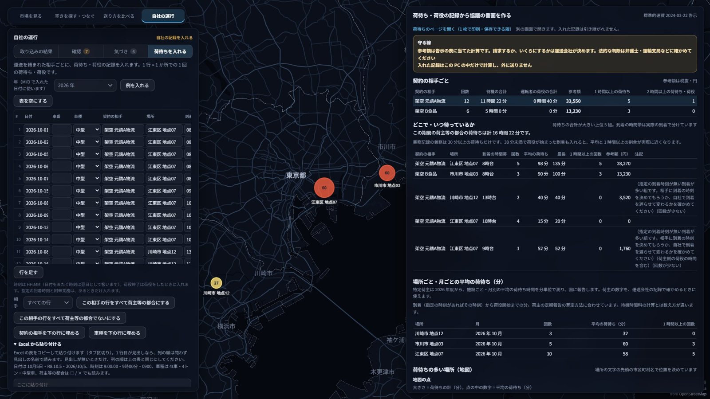

# Backfull

[](https://github.com/shirokuma-factory/hackathon_2026/actions/workflows/test.yml)

帰りの荷台を、中小の荷主の荷で埋める。

中小の運送会社は、荷主の都合で待たされた時間を法令どおり記録していても、それを相手と話せる形にする手間がかけられません。Backfull はまず、その記録を貼り付けるだけで、契約の相手ごとの参考額（国の標準的運賃の表に当てた額）、どこで・何時に着くと長く待つか、相手に渡す協議の書面を出します。これは明日から自社の記録で使えます。

その先にあるのが、空のまま走る帰りの荷台です。国の統計で帰りが空きやすい向きを地図に出し、その向きに荷を持つ小さな荷主とつなぐ流れを、架空の便で見せています（非商用、公開情報だけ）。



## 審査の方へ（3 分で見る）

| 時間 | 見るもの | 開き方 |
|---|---|---|
| 30 秒 | 荷待ちの記録から協議の書面（運送会社向け、明日から自社の記録で使える） | [入口のページ](https://shirokuma-factory.github.io/hackathon_2026/) →「いま試す」。または `web/waiting.html` をダウンロードしてブラウザで開き、「例を入れる」 |
| 30 秒 | 荷物の条件から送り方を比べる（荷主向け） | 入口のページ →「いま試す」。または `web/compare_lite.html` を開く |
| 2 分 | 地図の画面: 帰り便の偏りを見る → 空き便を探す → つなぐ → 荷待ちを地図で見る | [Codespaces で開く](https://codespaces.new/shirokuma-factory/hackathon_2026?quickstart=1)（起動すると地図の画面が開きます）か、下の「地図の画面」を手元で |
| 読む | 課題の根拠と、どこまで解けているか | [課題を解くツールになっているか](docs/plan/2026-11-05_課題を解くツールになっているか.md) |
| 読む | Claude Code をどう使ったか | [docs/CLAUDE_USAGE.md](docs/CLAUDE_USAGE.md)、試行錯誤は [docs/DEVLOG.md](docs/DEVLOG.md) |

### なぜ今か

| | 数字 | 出典 |
|---|---|---|
| 積載効率 | 営業用トラック 38.97%（2025 年度）。国の目標 44%（2028 年度）まで約 5 ポイント足りない | 自動車輸送統計年報 2025 年度 表 3-1 の輸送トンキロ ÷ 能力トンキロから計算。目標は「基本的な方針」（令和 7 年 2 月 18 日告示）。目標の土台の範囲は国の資料で未確認（SPEC §30.2） |
| 輸送力 | 対策をしないと 2030 年度に 34.1% 足りなくなるおそれ | 国土交通省「持続可能な物流の実現に向けた検討会 最終取りまとめ」（2023-08） |
| 荷待ち | トラックの 1 運行あたりの荷待ちは平均 1 時間 00 分（2025 年度。2024 年度は 1 時間 28 分）。減ってはいるが残っている。2026 年度から特定荷主に施設ごとの報告の義務 | 国土交通省 報道発表（令和 8 年 7 月 10 日）ほか。照合は [顧客の今のやり方の調査](docs/plan/2026-11-04_顧客の今のやり方の調査.md) §K |

### どこまでできているか

| 段階 | 中身 |
|---|---|
| 明日から自社のデータで使える | 荷待ちの記録から相手ごとの参考額・待つ場所と時間帯・協議の書面（`web/waiting.html`）。荷物の条件から送り方の比較と見積依頼文（`web/compare_lite.html`）。どちらもサーバー不要で、入れた記録はどこにも送らない |
| 仕組みを見せる段階 | 帰り便の照合と締切つきの仮予約、自社の運行から空の帰りの型を見つける流れ。便・会社・サンプルはすべて架空 |
| しないこと | 荷を運ばない、運賃を決めない、代金を預からない、発注しない |

帰り便のつなぎは、荷主と運送会社が直接契約する形にしています。Backfull は運送契約の当事者にならず、運賃も手数料も受け取りません。自ら運送を引き受ける第一種貨物利用運送事業（登録制）には当たらない設計で、運送の取次は 2003 年 4 月の改正で規制が廃止されています（[国土交通省 2003-02-14 の発表](https://www.mlit.go.jp/kisha/kisha03/01/010214_2_.html)）。同じ改正で、登録のない者が利用運送を行うかのように表示することは禁じられた（貨物利用運送事業法 第 51 条）ので、画面と文書で「運送を行う」とは書きません。事業にするときは、改めて専門家に確かめます。

### Claude Code の使い方（要点）

- 本線の Claude が仕様と受入条件（SPEC §1〜§33、受入条件 G01〜G143）を書き、実装は `coder`、調査は `researcher`、反証は `reviewer` に分けた。担当が重ならない仕様は git worktree で並行に実装した。
- 作成者の言葉から採点基準を作り、毎回前の点を知らない新しいエージェントに役（懐疑的な審査員、配車担当、荷主、CLO）を演じさせて採点し、指摘を SPEC と試験に落として直した。公開版の採点は 64 → 68 → 87 → 89。手順は Skill（[`.claude/skills/rubric-loop`](.claude/skills/rubric-loop/SKILL.md)）にした。
- 3D の車両・施設 18 種は、Claude が Blender MCP と画面なしの Blender で作り、手元の RTX 5080 で描いた。
- 試験は 900 件を超える（画面の試験は Edge か Chrome で回す）。push のたびに GitHub Actions で回し、公開リポジトリに秘密情報や PC 固有のパスが混ざると試験が落ちる（`tests/test_public_safety.py`）。
- 11/2〜11/6 で 150 を超えるコミット。失敗と作り直し（11/3 に「全然イメージと違う」と言われて地図中心に作り直した経緯など）は DEVLOG に残した。

## 使い方

### 荷待ちの記録から協議の書面を作る（サーバー不要）

`web/waiting.html` をブラウザで開きます（[GitHub Pages の版](https://shirokuma-factory.github.io/hackathon_2026/waiting.html?example=1)）。記録を表に入れるか Excel から貼り付けると、契約の相手ごとの参考額と書面の下書きが出ます。計算はブラウザの中だけで行い、通信しません。

### 荷物の送り方を条件から比べる（サーバー不要）

`web/compare_lite.html` をブラウザで開きます（[GitHub Pages の版](https://shirokuma-factory.github.io/hackathon_2026/compare_lite.html)）。荷物と区間を入れると、送り方ごとに使える・使えないと理由、貸切の国の目安額、見積依頼文が出ます。

### 地図の画面（全部の機能）

```bash
uv run python tools/serve_web.py
```

ブラウザで http://127.0.0.1:8600/ を開きます。画面は 1920×1080 を想定しています。

インターネットに公開する版は `--public` を付けて起動します。待ち受けるポートは環境変数 `PORT`（無ければ 8080）で決まります。公開版は OSRM の公開サーバーに問い合わせず、再配布できないデータ（P31）と各社の運賃の表を配信せず、見積依頼の窓口を並べず、仮予約などの状態を来訪者のブラウザごとに分けます。Cloud Run への公開手順は `docs/DEPLOY.md` です。

```bash
PORT=8080 uv run python tools/serve_web.py --public
```

| 見方 | できること | 仕様 |
|---|---|---|
| 全国の物流傾向 | 帰り便の偏り（物流センサス 2021）を地図で見る。課題の説明の画面 | SPEC §16.1 |
| 空きを探す・つなぐ | 荷主: 荷に合う帰り便を照合し、締切つきで仮予約。運送会社: 承諾、書面の下書き、値段の式（運送会社の役だけ）。便はデモの架空のもので、盤はサーバーのメモリにある | SPEC §16.2・§21 |
| 送り方を比べる | 手段ごとの目安額・使えない理由・見積依頼文・見積回答の比較と保存 | SPEC §14・§15・§17 |
| 自社の運行 | 架空の会社のサンプルで、空車の型・停車・拘束時間などの気づき。「荷待ちを入れる」タブは自社の記録で使える | SPEC §22・§23 |

### 試験

```bash
uv run pytest -q
```

計算部分（`src/`）を直したら、サーバーを起動し直してください。

## 仕組み

| 部分 | 内容 |
|---|---|
| `src/shipcompare/` | 目安額、照合と仮予約（`spaceb.py`）、荷待ちの計算（`waiting.py`）、自社の運行（`own.py`）などの純粋な関数 |
| `tools/serve_web.py` | 標準ライブラリだけの配信サーバーと API（手元の版は 127.0.0.1 だけ。`--public` で公開版、`docs/DEPLOY.md`） |
| `web/` | 地図の画面（MapLibre + deck.gl）と `waiting.html` |
| `data/` | 運賃・標準的運賃の表・場面・架空の便とサンプル（すべて出典・確認日つき） |
| `app/main.py` | 最初の版の Streamlit の画面（見積比較） |

開発は Claude Code が司令塔になり、実装・調査・レビューをサブエージェントに分けて行いました。詳細は [docs/CLAUDE_USAGE.md](docs/CLAUDE_USAGE.md)。

## ドキュメント

| ファイル | 内容 |
|---|---|
| [SPEC.md](SPEC.md) | 仕様と受入条件 |
| [docs/plan/2026-11-05_課題を解くツールになっているか.md](docs/plan/2026-11-05_課題を解くツールになっているか.md) | 課題、今のアプリの判定、変更、正しいと言える範囲 |
| [docs/plan/2026-11-04_解決の筋書き.md](docs/plan/2026-11-04_解決の筋書き.md) | 使う人の立場での筋書き |
| [docs/plan/2026-11-04_顧客の今のやり方の調査.md](docs/plan/2026-11-04_顧客の今のやり方の調査.md) | 求荷求車、法令、標準的運賃の告示などの一次資料 |
| [docs/DEVLOG.md](docs/DEVLOG.md) | 試行錯誤の記録 |
| [docs/CLAUDE_USAGE.md](docs/CLAUDE_USAGE.md) | 使った Skills・MCP・サブエージェント・フックと理由 |

## 未実装

| 項目 | 理由 |
|---|---|
| 自社のファイル（Excel の配車表・デジタコの CSV）の取り込み | 次の版。今はサンプルだけ |
| 帰り便の盤の保存と、別の場所からの利用 | 今はサーバーのメモリのデモの盤。保存先・本人確認・許可番号の確認が要る |
| 家財の配送・赤帽・ハコベル・PickGo の条件を比べる画面に足す | 設計だけ |
| 実在の利用者での効果の確認 | 協力する運送会社・荷主が未定 |

## ライセンスとデータの条件

コード（`src/`・`tools/`・`web/` の JS・CSS・HTML・`tests/`）は MIT ライセンスです（[LICENSE](LICENSE)）。データは元の条件に従います。

| データ | 場所 | 条件 |
|---|---|---|
| OpenStreetMap 由来（物流施設・港・貨物駅・航路、OSRM の道路距離と経路） | `data/geo/osm_*`、`data/geo/osrm_*`、`web/data/routes*` など | ODbL 1.0。© OpenStreetMap contributors |
| 市区町村・都道府県の境界（国土数値情報 N03 の簡略版） | `data/geo/*_s0010.geojson` | 「国土数値情報（行政区域データ）」（国土交通省）を加工して作成 |
| 物流センサス・経済センサス・国勢調査 | `data/stats/` | 政府標準利用規約（第 2.0 版）。各ファイルの `source` に出典 |
| 道路の交通量（大型車） | `data/traffic/`、`web/data/jartic.json` | 「国土交通省 API 機能による交通量(参考値)を加工して作成」。集計した値だけを置き、API の応答そのものは置かない |
| 標準的運賃（告示） | `data/tariffs/mlit_*` | 告示は著作権法 13 条により権利の目的とならない |
| 民間 3 社の運賃の一部の値 | `data/tariffs/sagawa_*`・`nittsu_*`・`yamato_*` | 手元の版の試算のために、デモの区間のセルだけを出典 URL・確認日つきで持つ。表の全体は持たず、公開版では配信せず、画面に会社名と額を出さない（SPEC §30）。判断の経緯は [地図データと利用条件](docs/plan/2026-11-03_地図データと利用条件.md) |
| 国土数値情報 P31（物流拠点） | 置かない | 再配布できないので、取得の台本（`tools/fetch_p31.py`）だけ |
| 架空の会社・便・サンプル | `data/demo/`、`data/own_sample/` | このリポジトリで作った架空のデータ |

## データの扱い

- 荷待ちのページ（`web/waiting.html`）は通信しません。入れた記録はそのブラウザの中（localStorage）にだけ保存され、「保存した記録を消す」で消せます。共有の PC では使い終わったら消してください。
- 業務記録の乗務員の氏名の列は読み込まずに捨てます（SPEC §23.8）。
- 公開版のサーバーは来訪者ごとの状態をメモリにだけ持ち、2 時間使われなければ捨てます。ファイルには書きません。
