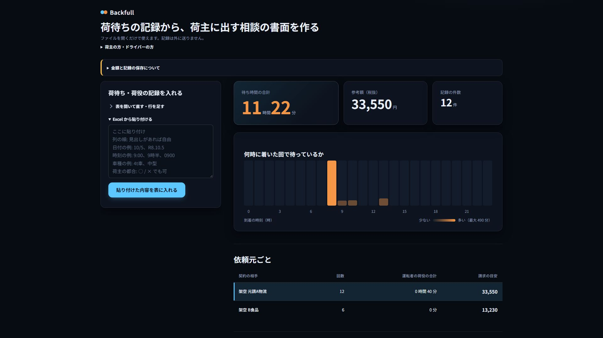
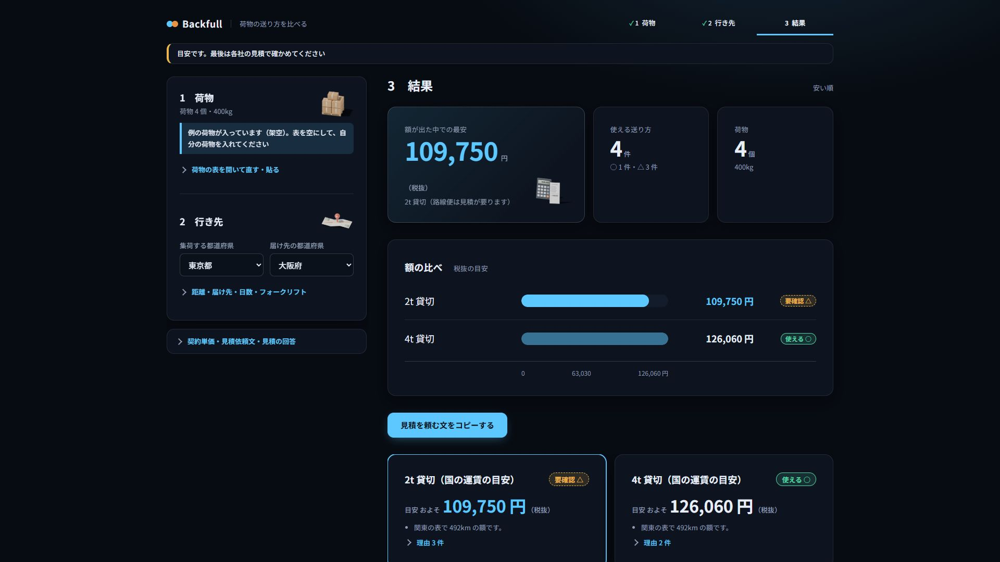
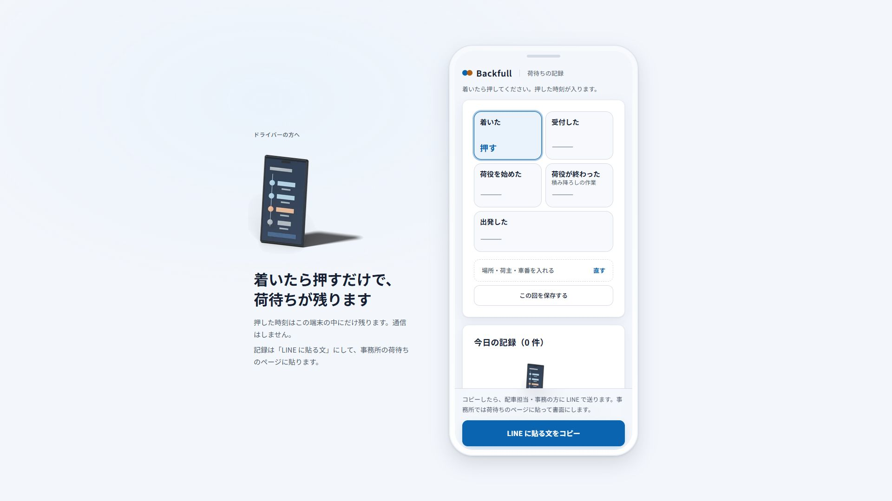
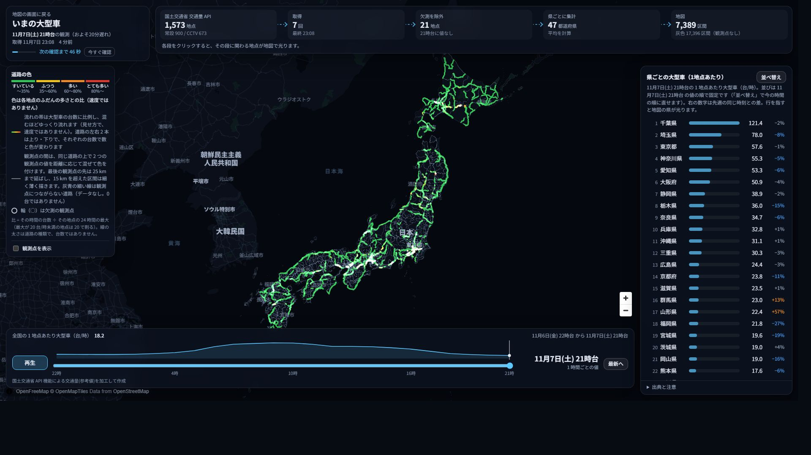
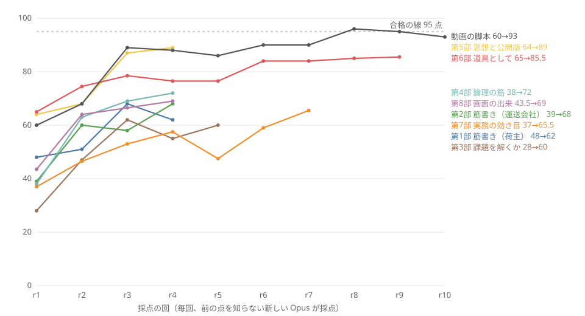
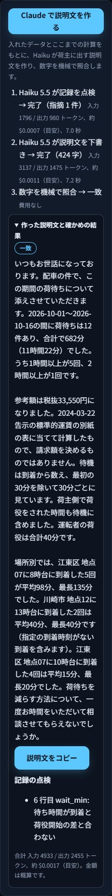

# Backfull

**荷待ちの記録を、荷主との相談の書面に。空で走る帰りを、荷主への提案に。**

中小の運送会社と中小の荷主が、手元の記録だけで、荷待ちの相談・空いた帰りの提案・送り方の比べをするためのツールです。Built with Claude: Japan 2026 のテーマ 2「本来、誰にでも届くべきものを。」への提出作品です。

<sub>言葉: **荷待ち**＝トラックが荷主の倉庫などに着いてから、荷を積み降ろしできるまで待たされる時間。**帰り便**＝荷を届けたあと、空のまま戻る車。**元請**＝荷主から仕事を受けて、実際に運ぶ会社に回す運送会社。**デジタコ**＝車の速度・距離・時刻を記録する機械（デジタルタコグラフ）。**標準的運賃**＝国土交通省が告示した、トラックの運賃と待機時間料の目安。</sub>

**デモ動画（3 分）:** https://youtu.be/D59OlKkG7W8

[](https://youtu.be/D59OlKkG7W8)

**今すぐ試す:** https://backfull-demo-720575644376.asia-northeast1.run.app/waiting.html （架空の荷待ちの記録が入っていて、開くとすぐ参考額と相談の文が出ます。インストール不要）

## すぐ試す（インストール不要）

| やりたいこと | 開く場所 |
|---|---|
| 荷待ちの記録から、荷主との相談の書面を作る | https://backfull-demo-720575644376.asia-northeast1.run.app/waiting.html |
| 自社の配車表・デジタコから、空いた帰りを見る | https://backfull-demo-720575644376.asia-northeast1.run.app/own_lite.html |
| 荷物の条件から、送り方を比べる | https://backfull-demo-720575644376.asia-northeast1.run.app/compare_lite.html |
| ドライバーのスマートフォンで、荷待ちの時刻を残す | https://backfull-demo-720575644376.asia-northeast1.run.app/driver.html |
| 地図の画面（全部の機能） | https://backfull-demo-720575644376.asia-northeast1.run.app/ |

どのページも、開くと架空の例が入っているか、「架空のサンプルで試す」を押すと結果まで見られます。ファイル 1 枚のページ（上の 4 つ）は、入れた記録をブラウザの外に送りません。計算はブラウザの中だけで行います。公開版は使われていない間は止まっているので、最初の 1 回は開くまで十数秒かかります。



## 誰が、何に困っているか

荷待ちは、運送会社には見えていて、荷主には見えていません。

| 数字 | 内容 | 出典 |
|---:|---|---|
| 69% と 21% | 荷待ちが起きていると答えた割合。実運送の会社は約 69%、荷主（出荷）は約 21% | 国土交通省「トラック輸送状況の実態調査」（荷主 666 社・運送事業者 984 社、2022 年） |
| 3〜5 割 | 荷役料金・待機時間料を荷主から受け取れている実運送の会社 | 国土交通省「『標準的な運賃』の見直しについて」2024-01（令和 3 年度の実態調査） |
| 67.7% | 物流費が上がったと答えた中小企業のうち、その分を価格に転嫁できていない割合（荷主の側の困りごと） | 日本商工会議所「中小企業における物流効率化の取組み等について」2024-08（有効回答 1,994 社） |
| 1 年 | 2025 年 4 月から、10 両以下の会社も全車両で、荷待ち 30 分以上・荷役 1 時間以上を業務記録に書き、1 年残す義務がある | 貨物自動車運送事業輸送安全規則 第 8 条第 1 項第 7 号・第 8 号 |

一次資料での照合は [docs/plan/2026-11-03_課題の出典.md](docs/plan/2026-11-03_課題の出典.md)（A2・B6・B9、照合 111 件・不一致 0 件）と [docs/plan/2026-11-04_自社データの形と記録義務の調査.md](docs/plan/2026-11-04_自社データの形と記録義務の調査.md) にあります。

## 届いていない人と、その人を阻む壁

| 届いていない人 | 大手が持っているもの | 壁 | Backfull で外す壁 | 外せない壁 |
|---|---|---|---|---|
| 中小の運送会社の事務・経営者 | 荷主と交渉する部署、運賃の相場を読む人 | 記録はあるが、相談に使える額と書面にする手間と知識が無い | 業務記録を貼ると、標準的運賃の表に当てた参考額と相談の書面の下書きが出る | 荷主が応じるかどうか |
| ドライバー | 運行管理のシステム | 待った時刻を紙やメモで残し、事務に渡すまでに崩れる | スマートフォンで押した時刻が、LINE に貼れる文になる | — |
| 中小の運送会社の配車 | 求荷求車の網、帰り荷を探す担当 | 空で走る帰りの区間と曜日が、配車表の中に埋もれている | 配車表・デジタコの CSV から、空いた帰りの区間と曜日、荷主に出す提案の文が出る | 毎日の配車そのもの（このツールは減らさない） |
| 中小の荷主 | 物流の部署、複数の運送会社との契約 | どの送り方が使えるか、貸切の相場がいくらか分からない | 荷物の条件から、使える送り方と使えない理由、貸切の国の目安額、見積依頼の文が出る | 実際の運賃（見積を頼む必要がある） |

## 使う場面の例（架空の記録）

| 場面 | 入れるもの | 出るもの |
|---|---|---|
| 月の締めに、元請との相談の材料を作る | 架空の元請 A 物流の 12 回の記録（2026-10-01〜16） | 待ち時間の合計 11 時間 22 分、標準的運賃の表に当てた参考額 33,550 円（税抜）。江東区の地点に 8 時台に着いた 5 回は平均 98 分待ち、10 時台の 4 回は平均 15 分。到着の時刻をずらす相談ができる |
| 空いた帰りを荷主に提案する | 架空の会社の配車表とデジタコ（江東 → 鹿屋） | 鹿屋を土曜の夜に出た帰りの 5 便がすべて空車、ほかの曜日は 40 便中 15 便が空車。荷主に相談する文を作れる |
| 荷物の送り方を比べる | 4 個・400kg、東京都 → 大阪府 | 使える送り方 4 つ（○ 1・要確認 3）と、それぞれの理由。2t 貸切の国の目安 109,750 円、4t 貸切 126,060 円（税抜）。見積を頼む文 |




| ドライバーの 1 枚 | いまの大型車（国の観測点の大型車の数。遅れの分は画面に出る） |
|---|---|
|  |  |

## ハッカソンのあと、誰がどう使い続けるか

| 誰が | いつ | 何をする | 続けられる理由 |
|---|---|---|---|
| 運送会社の事務 | 毎月の締め | 法令で残している業務記録を貼り、契約の相手ごとの参考額と相談の書面を出す | 記録は法令で既に残しているもので、新しい作業を増やさない。ファイル 1 枚で動き、サーバーも契約も要らない |
| ドライバー | 毎回の荷待ち | 時刻を押して残し、LINE で事務に送る | ホーム画面に置け、通信しない |
| 運送会社の経営者・配車 | 月に 1 回 | 配車表・デジタコの CSV で、空いた帰りの区間と曜日を見て、荷主に提案する | CSV を落とすだけ。ファイルは外に送らない |
| 中小の荷主 | 出荷の条件が変わったとき | 送り方を比べ、見積を頼む文を作る | 自社の契約単価を入れると、その額で並ぶ |

実在の会社のファイルでは、まだ確かめていません。実際の記録に似せた架空のサンプル（`examples/`、`tests/`）で確かめています。読めなかった行は、画面に行と理由が出ます。コードは MIT ライセンスで、自社で動かせます。

## 試行錯誤の跡



6 日間で 314 件のコミットと 2,277 件の自動試験を作りました。前の点を知らない Opus に、審査員・配車担当・荷主の役で採点させ、点が頭打ちになったら基準か作り方を替えました（採点・監査の記録 119 件）。最初に作った見積比較の画面は 11/3 に捨て、地図を中心に作り直しています。

| 日 | 分かったこと | 変えたこと |
|---|---|---|
| 11/3 | 最初に作った見積比較は、作成者が求めた形（地図で市場の偏りを見る）と違った | 地図の Web アプリに作り直した |
| 11/5 | 文書を直しても、点の差が採点者ごとのぶれより小さい | 文書をやめ、仕様を書いて実装し、画面と試験で採点を続けた |
| 11/6 | 仕事が確かに減るのは、荷待ちの記録から書面までの流れだけ | 配車表の書き方を追いかけるのをやめ、荷待ちの書面と空いた帰りの提案に絞った |

作り直した判断の全部、試して採らなかったもの、止めた判断は [docs/試行錯誤の記録.md](docs/試行錯誤の記録.md) に、提出前のリポジトリの採点（5 人、平均 76.5 → 92.2 点）は [docs/reviews/2026-11-08_リポジトリの採点_推移.md](docs/reviews/2026-11-08_リポジトリの採点_推移.md) にあります。

## Claude の使い方

回数は、手元の PC の Claude Code のセッションの記録を `tools/submission/session_stats.py` で数えた値です（時点と内訳は [docs/CLAUDE_USAGE.md](docs/CLAUDE_USAGE.md)）。

| 使い方 | 内容 | 記録 |
|---|---|---|
| アプリの中で Claude を使う | 4 つの補助に Haiku 5.5 を使う: 荷待ちの相談の説明文（記録の点検と下書き。数字は機械で照合し、合わなければ出さない。Opus 5.5 の確かめも足せる）、自社の運行のファイルの列の整理、帰り便の案内文の整え、荷物を文で書いて表にする。どれも既定は止めてあり、押したときだけ動く。金額は試験で確かめた関数で出し、AI に決めさせない | SPEC §53、`src/shipcompare/ai_explain.py` |
| 採点者を演じる Opus の反復 | 第 1〜8 部と動画の脚本。観点の違う 2 人を Workflow で同時に動かし、点がぶれの中に入ったら止めた | [docs/試行錯誤の記録.md](docs/試行錯誤の記録.md) |
| 実装を Sonnet に分ける | coder（Sonnet）197 回、git worktree で最大 5 人を同時に。サブエージェントの応答の 74% が Sonnet | [docs/CLAUDE_USAGE.md](docs/CLAUDE_USAGE.md) |
| 一次資料の照合 | researcher（Opus）が法令・告示・統計を開いて照合 | [docs/plan/2026-11-03_課題の出典.md](docs/plan/2026-11-03_課題の出典.md) |
| 3D と動画を MCP で作る | Blender・ComfyUI・DaVinci Resolve を Claude Code から動かした | [docs/LOCAL_AI.md](docs/LOCAL_AI.md) |
| スキルとフック | 採点の反復を `rubric-loop` スキルにまとめた。フックで、コミットを DEVLOG に、生成を `docs/generation_log.jsonl` に自動で記録し、`.env` への書き込みを止めた。フックが「動いていない」と書いていた誤りは、記録を数えて見つけて直した | [docs/CLAUDE_USAGE.md](docs/CLAUDE_USAGE.md) |
| 作成者とのやり取りの型 | 公開・課金・削除・履歴の書き換えは、作成者に 1 回聞いてから行う。作成者しか決められないこと（作り直しの方向、素材の採否、権利の判断）は選択肢で聞き、判断は日付つきのファイルに残す。複数のセッション（アプリ・動画・リポジトリ整備）がメッセージで依頼し合い、同じファイルを同時に書かないように分けた | [docs/plan/2026-11-07_提出前のリポジトリ整備.md](docs/plan/2026-11-07_提出前のリポジトリ整備.md) |

荷待ちのページで「Claude で説明文を作る」を押したときの画面です（手元のサーバーで本物の API を 1 回だけ使って撮影。公開版では止めてあります）。

| 送る前の確認（相手と地点は置き換えて送る） | 送ったあと（Haiku の点検と下書き、数字の機械照合「一致」） |
|---|---|
|  |  |

## データの扱いと、安心して使うために

| ページ | 外に送るもの |
|---|---|
| ファイル 1 枚のページ（`waiting.html`・`own_lite.html`・`compare_lite.html`・`driver.html`） | 記録は送らない。計算はブラウザの中だけ。ファイルを直接開いたときは通信もしない。サーバーから開いた荷待ちのページだけは、説明文の自動作成が使えるかを 1 回問い合わせる（`/api/ai/status`、記録は含まない） |
| 地図の画面 | 帰り便の照合と仮予約だけをサーバーに送る（架空の便のデモ。来訪者ごとに分け、メモリにだけ置き、上限つき） |
| AI の補助（SPEC §53） | 既定は止めてある。サーバーで有効にしたとき（`AI_EXPLAIN_ENABLED=1`、公開先は `AI_EXPLAIN_PUBLIC=1` も）だけ、送る中身を画面で見せ、「送る」を押したときだけ Anthropic の API（Haiku 5.5）に送る。送るのは次だけで、サーバーが欄を検め、決まった形でなければ断る。本物の API で 4 つを 1 回ずつ動かし、照合を通ることと費用（合計 約 0.0017 ドル）を確かめた（[docs/reviews/2026-11-08_AIの実測.md](docs/reviews/2026-11-08_AIの実測.md)）。自動試験は API を呼ぶ部品を差し替えて行う |
| 　荷待ちの説明文 | 計算済みの事実（時刻・分・額・根拠の文）。相手の名前は「荷主A」、地点名は「地点1」に置き換え、車番は消してから送る |
| 　自社の運行の列の整理 | 列の見出しと、値の形の要約（形の種類・埋まっている割合）。値と行は送らない。送る中身を画面で見せてから送る |
| 　帰り便の案内文の整え | 社内の情報（車番・原価・入れた金額など）を外したあとの案内文の本文 |
| 　荷物を文で書いて表にする | 利用者が書いた荷物の説明の文。返ってきた表の数字は、元の文と機械で照合する |

- セキュリティ診断: [docs/reviews/2026-11-07_セキュリティ診断.md](docs/reviews/2026-11-07_セキュリティ診断.md)（高 0 件。中 2 件は直した: 公開版の仮予約・項目の数と長さの上限、CSV を Excel で開いたときに式として動かないようにする処理）
- データ・地図・素材の権利: [docs/素材とデータの権利.md](docs/素材とデータの権利.md)
- ライセンス: [LICENSE](LICENSE)（MIT。データと地図は各出典の条件に従う）

## 期間中に作ったもの

| 区分 | 中身 | 確かめ方 |
|---|---|---|
| イベントの前から持っていた開発の道具（アプリの機能ではない） | 最初のコミット `35e4866`（2026-11-03 00:11、23 ファイル・934 行）の `.claude/`（サブエージェント・スキル・フック）、`tools/local_ai_mcp/`、`scripts/` | `git show --stat 35e4866` |
| 期間中（11/3〜11/8）に作ったもの | アプリのすべて（`src/`・`web/`・`tools/serve_web.py`・`data/`・`tests/`）、仕様、計画・調査・採点の記録、動画。道具を期間中に直した所（フックの修正 `1c24f0a` など）も含む | `git log --reverse` |

| 日 | 11/3 | 11/4 | 11/5 | 11/6 | 11/7 | 11/8 |
|---|---:|---:|---:|---:|---:|---:|
| コミット | 42 | 16 | 72 | 38 | 60 | 86 |

キックオフは 2026-11-02 12:00 です。

## 手元で動かす

Python 3.13 と [uv](https://docs.astral.sh/uv/) が要ります。

```bash
uv sync
uv run python tools/serve_web.py
```

ブラウザで http://127.0.0.1:8600/ を開きます（1920×1080 を想定）。ファイル 1 枚のページ（`web/waiting.html` など）は、ファイルをそのまま開いても動きます。

```bash
uv run pytest -n 8
```

公開版は `--public` を付けて起動します（`PORT` で待ち受けるポート）。公開版は外部の経路のサーバーに問い合わせず、再配布できないデータと各社の運賃の表を配信せず、仮予約などの状態を来訪者ごとに分けます。Cloud Run への公開の手順は [docs/DEPLOY.md](docs/DEPLOY.md) です。

### 地図の画面でできること

| 見方 | できること | 仕様 |
|---|---|---|
| 全国の物流傾向 | 帰り便の偏り（物流センサス 2021）を地図で見る | SPEC §16.1 |
| 空きを探す・つなぐ | 荷主: 荷に合う帰り便を照合し、締切つきで仮予約。運送会社: 承諾、書面の下書き、値段の式。便はデモの架空のもの | SPEC §16.2・§21 |
| 送り方を比べる | 手段ごとの目安額・使えない理由・見積依頼文・見積回答の比較と保存 | SPEC §14・§15・§17 |
| 自社の運行 | 自社の配車表・デジタコの CSV を落とすと、実車率・空車の型・停車・拘束時間などの気づきが出る（ブラウザの中だけで計算）。手引きは [docs/guide/自社の運行を分析する.md](docs/guide/自社の運行を分析する.md)、例のファイルは `examples/own/` | SPEC §22・§23・§35 |

地図の描き方（流れの矢印、運行の区間、時間の帯、荷室の 3D）は、自社の画面に組み込める部品として `web/kit/` に置いています（SPEC §36）。例は `examples/kit/index.html`、使い方は [docs/guide/部品の使い方.md](docs/guide/部品の使い方.md) です。

## 仕組み

| 部分 | 内容 |
|---|---|
| `src/shipcompare/` | 目安額、照合と仮予約（`spaceb.py`）、荷待ちの計算（`waiting.py`）、自社の運行（`own.py`）、説明文の自動作成（`ai_explain.py`）などの関数 |
| `tools/serve_web.py` | 標準ライブラリだけの配信サーバーと API |
| `web/` | 地図の画面（MapLibre + deck.gl）とファイル 1 枚のページ。`own_calc.js`・`waiting_calc.js` は Python と同じ結果になる JS（共通の試験表で確かめる） |
| `data/` | 運賃・標準的運賃の表・場面・架空の便とサンプル（出典・確認日つき） |
| `tests/` | 自動試験 2,277 件（手元の PC で全件を流した結果は [docs/reviews/2026-11-08_全件の試験.md](docs/reviews/2026-11-08_全件の試験.md)）。GitHub Actions でも push のたびに流す。ただし Actions の Linux には Edge が無いので、画面を開く試験は飛ばし、残りを流す（`.github/workflows/test.yml`） |

## もっと読む

読む順と全体の目次は [docs/README.md](docs/README.md) にあります。

| ファイル | 内容 |
|---|---|
| [SPEC.md](SPEC.md) | 仕様と受入条件 |
| [docs/plan/2026-11-05_課題を解くツールになっているか.md](docs/plan/2026-11-05_課題を解くツールになっているか.md) | 課題、判定、正しいと言える範囲 |
| [docs/試行錯誤の記録.md](docs/試行錯誤の記録.md) | 作り直しの判断、採点の推移 |
| [docs/CLAUDE_USAGE.md](docs/CLAUDE_USAGE.md) | Claude Code の使い方（回数と理由） |
| [docs/DEVLOG.md](docs/DEVLOG.md) | 日ごとの記録 |

## 未実装

| 項目 | 理由 |
|---|---|
| 自社の Excel ファイル（.xlsx）の直接の取り込み | CSV（UTF-8・Shift_JIS）だけ読める。紙の日報・チャート紙は読まない |
| 自社の車両の登録（最大積載量・車両総重量）の取り込み | 大型の最大積載量は仮定（10t）で、画面で変えられる |
| 帰り便の盤の保存と、別の場所からの利用 | 今はサーバーのメモリのデモの盤。保存先・本人確認・許可番号の確認が要る |
| 実在の利用者での効果の確認 | 協力する運送会社・荷主が未定 |
