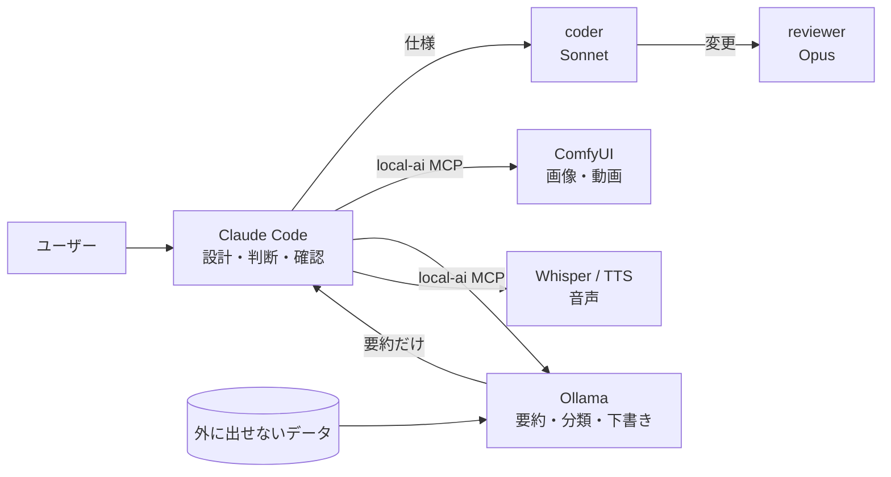

# ローカル AI の使い方

Claude Code が判断と設計を担当し、ローカル GPU 上のモデルが生成・大量処理・外に出せないデータの処理を担当します。

## ハードウェア

| 項目 | 値 |
|---|---|
| GPU | NVIDIA GeForce RTX 5080（VRAM 16GB） |
| RAM | 64GB |
| OS | Windows 11 |
| ComfyUI | Comfy Desktop（127.0.0.1:8188）、バージョン: |
| torch / CUDA | （`python -c "import torch;print(torch.__version__)"` の結果） |
| Ollama | バージョン: |

## 役割分担

| 処理 | 担当 | 理由 |
|---|---|---|
| （例）現場写真の分類 | ローカル LLM / VLM | 写真をクラウドに送らないため |
| （例）分類結果の判断と報告書 | Claude | |
| （例）デモ用の画像生成 | ComfyUI | |

## 使ったモデルと選んだ理由

| 用途 | モデル | 形式・量子化 | VRAM | ライセンス | 選んだ理由 |
|---|---|---|---|---|---|
| | | | | | |

## ComfyUI ワークフロー

API 形式の JSON は `workflows/comfyui/` にあります。

| ファイル | 内容 | 主なノード |
|---|---|---|
| | | |

## 実測値

`docs/generation_log.jsonl` から転記します。1回目はモデルの読み込みを含みます。

| 処理 | 条件（解像度・コマ数・steps） | 1回目 | 2回目以降 | VRAM 最大 |
|---|---|---|---|---|
| | | | | |

参考（2026-09 にこの PC で測った値）:

| 処理 | 条件 | 時間 | VRAM 最大 |
|---|---|---|---|
| Z-Image Turbo | 1024×1024、8 steps | 冷 14.7秒 / 温 5.0秒 | |
| Wan2.2 I2V A14B（GGUF Q5_K_M + Lightning 4step） | 832×480、81コマ | 108秒 | 14.3GB |

## 環境の注意

- モデルの置き場所は `C:\ai\models` と `ComfyUI-Shared\models` の2か所。落とす前に両方を確認する。
- RTX 50 系では、CUDA 版のホイールと torch のタグを厳密に合わせる。
- 学習やほかの GPU 作業の前に `comfy_free` で VRAM を空ける。
- Hugging Face からの大容量ダウンロードは止まりやすい。`curl -C -` で再開する。
