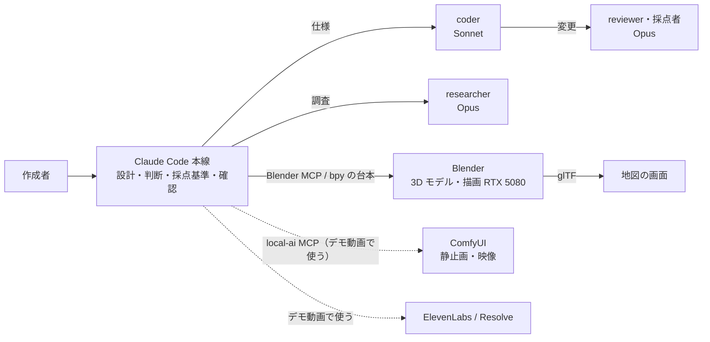

# ローカル AI の使い方

Claude Code が判断と設計を担当し、ローカル GPU 上のモデルが生成・大量処理・外に出せないデータの処理を担当します。

## ハードウェア

| 項目 | 値 |
|---|---|
| GPU | NVIDIA GeForce RTX 5080（VRAM 16GB） |
| RAM | 64GB |
| OS | Windows 11 |
| ComfyUI | Comfy Desktop（127.0.0.1:8188）、ComfyUI 0.43.2、フロントエンド 1.57.4 |
| Python（ComfyUI） | 3.13.12 |
| torch / CUDA | 2.12.1+cu130 |
| Ollama | 導入していない（11/2 の作成者の判断）。LM Studio に gemma-4-12b-qat（7.2GB）・gemma-4-26b-a4b-qat（15.6GB）・qwen3.8-27b（17.7GB）・nomic-embed があるが使っていない |
| Blender | 5.2.2（Cycles、OptiX、OptiX Denoiser） |

## 役割分担



点線はデモ動画の制作で使う予定のもの。Ollama（ローカル LLM）は導入していません。

| 処理 | 担当 | 理由 |
|---|---|---|
| 仕様・判断・採点基準・最終の確認 | Claude（本線、Opus） | |
| 実装 | coder（Sonnet） | |
| 3D モデルの形づくり、軽い版、glTF の書き出し | Blender（Claude が bpy の台本を書き、Blender MCP か画面なしで実行） | 手元の GPU で何度でも同じ結果を作れる |
| サムネイル・回転映像の描画 | Blender Cycles（RTX 5080、OptiX） | |
| デモ動画の説明の静止画・映像 | ComfyUI（`local-ai` MCP の `comfy_run_workflow`）。デモ動画の制作で使う | |
| 荷待ちの記録（運送会社の業務記録）の計算 | 利用者のブラウザの中（計算は通信しない。Claude で説明文を作るときだけ、確認のうえ名前を置き換えた計算結果を送る） | 記録を外に出さない |
| 自社の運行の列の対応の提案 | Claude（開発のセッション）。送ったのは列名と値の形の説明だけで、実際の値・氏名・荷主名・地点名は送っていない（SPEC §22 G71） | 外に出せない値をクラウドに送らない |

アプリの開発で使ったデータは公開の統計・告示と架空のサンプルだけで、外に出せないデータ（現場の写真、個人情報）は扱っていません。

## 使ったモデルと選んだ理由

| 用途 | モデル | 形式・量子化 | VRAM | ライセンス | 選んだ理由 |
|---|---|---|---|---|---|
| 3D の描画 | Blender Cycles（モデルではなくレンダラー） | — | 未測定 | GPL（Blender） | 手元の RTX 5080 で OptiX が使え、glTF をそのまま地図に載せられる |
| デモ動画の静止画・映像 | デモ動画の制作のときに書く（参考値の Z-Image Turbo、Wan2.2 I2V を候補にする） | | | | |

## ComfyUI ワークフロー

API 形式の JSON は `workflows/comfyui/` に置きます。デモ動画の制作で使うときに、この表に 1 行ずつ足します（今は 0 本）。

| ファイル | 内容 | 主なノード |
|---|---|---|
| `backfull_t2i_zimage.json` | デモ動画の冒頭の静止画（1344×768、28 steps、cfg 4） | UNETLoader（z_image_bf16、fp8）、CLIPLoader（qwen_3_4b）、ModelSamplingAuraFlow、KSampler |
| `backfull_i2v_wan22.json` | 静止画から 4 秒の動き（832×480、65 コマ、Lightning 4 steps） | UnetLoaderGGUF（Wan2.2 I2V A14B Q5_K_M）、LoraLoaderModelOnly（lightx2v）、WanImageToVideo、KSamplerAdvanced 2 段 |

## 実測値

### Blender（2026-11-04、RTX 5080）

作ったもの: 乗り物と施設のモデル 18 種（7 種は Blender MCP、11 種は画面なしの Blender）、小物 17 種（T11 パレット、カゴ台車、宅配箱 60〜160、フォークリフト、LD3、20ft・31ft・12ft 冷凍コンテナ、コキ、ドックレベラーほか、各 60KB 以下）、軽い版 18 種（`web/models/lo/`）。台本は `assets3d/source/`。

| 処理 | 条件 | 時間 | VRAM 最大 |
|---|---|---|---|
| サムネイル 35 枚 | 640×400、64 サンプル → 320×200 の透過 WebP | 1 枚 0.4 秒、計 13 秒 | 未測定 |
| 回転映像 18 本 | 1920×1080、96 サンプル、24fps、計 2,544 コマ | 1 コマ 1.35〜2.11 秒（平均 1.87 秒）、計 約 4,760 秒（約 79 分。見積 51 分より、ほかの GPU の負荷で伸びた） | 未測定 |
| 4K の並び画像 | 192 サンプル | 16 秒 | 未測定 |
| 軽い版の作成 | 三角形を元の 13〜25%、ファイル約 3 分の 1、1 材質 + 128×4 のパレット画像 | — | — |

分かったこと: 回転映像の床に照明の反射の帯が出た（直すと再描画に約 80 分かかるので残した）。並び画像は実寸の比ではない（トラック 3.4 倍、RORO 船 0.36 倍など）。高詳細版の材質の統合は 200KB を超えるので見送った。軽い版の数字は `web/models/lod.json`。

### 地図の画面（RTX 5080、1440×900、10 秒）

| 場面 | fps | 1 コマの時間 |
|---|---|---|
| 市場を見る | 122 | p95 12.4 ms |
| 比べる | 88〜102 | 最長 62〜114 ms |
| 拡大 | 113〜119 | 最長 88〜137 ms |

内蔵 GPU とヘッドレス Edge での測定は `docs/DEVLOG.md` と SPEC §19.5・§19.5b。

### ComfyUI

`docs/generation_log.jsonl` から転記します（デモ動画の制作から）。1回目はモデルの読み込みを含みます。

| 処理 | 条件（解像度・コマ数・steps） | 1回目 | 2回目以降 | VRAM 最大 |
|---|---|---|---|---|
| Z-Image（base、fp8）で冒頭の静止画 6 枚（2026-11-06） | 1344×768、28 steps | 66.6 秒 | 50.5〜85.2 秒 | 15.6GB（全体の使用量。録画の Edge と同時） |
| Wan2.2 I2V（2026-11-06） | 832×480、65 コマ | 30 分を超えても終わらず中止 | — | VRAM の空きが約 3.5GB（ComfyUI 以外のアプリが 12.5GB を使用）で、モデルの一部を外に逃がして動いていた。冒頭の動きは静止画への寄り（ffmpeg の zoompan）に替えた |

参考（2026-09 にこの PC で測った値）:

| 処理 | 条件 | 時間 | VRAM 最大 |
|---|---|---|---|
| Z-Image Turbo | 1024×1024、8 steps | 冷 14.7秒 / 温 5.0秒 | |
| Wan2.2 I2V A14B（GGUF Q5_K_M + Lightning 4step） | 832×480、81コマ | 108秒 | 14.3GB |

## 環境の注意

- モデルの置き場所は `C:\ai\models` と `ComfyUI-Shared\models` の2か所。落とす前に両方を確認する。
- RTX 50 系では、CUDA 版のホイールと torch のタグを厳密に合わせる。
- 学習やほかの GPU 作業の前に `comfy_free` で VRAM を空ける。
- Hugging Face からの大容量ダウンロードは止まりやすい。`curl -C -` で再開する。

## トラブルと対処

### 2026-11-03 ComfyUI が起動直後に落ちる（chardet のネイティブ拡張）

- 症状: Comfy Desktop は起動するが、サーバーが `0xC0000005`（access violation）で終了し、8188 番が開かない。
- 原因: スタックトレースは `comfyui_manager` → `requests` → `chardet\detector.py` の 23 行目。chardet に同梱されたコンパイル済み拡張の読み込みで落ちていた。GPU・モデル・ComfyUI 本体の問題ではない。
- 対処: ComfyUI の venv の chardet を、ネイティブ拡張を含まない 5.2.0 に入れ替えた。
  ```powershell
  uv pip install --python <ComfyUI の .venv>\Scripts\python.exe "chardet==5.2.0"
  ```
- 確認: 再起動後に `/system_stats` が応答し、RTX 5080 を認識（VRAM 空き 15.6GB）。
- 再発の条件: ComfyUI Manager や Comfy Desktop の更新で chardet が新しい版に戻ると再発しうる。同じ症状が出たら同じ対処をする。

## MiniMax H3 と SeedVR2 の実測（2026-11-06）

冒頭の C1・C2 を、実写の写真（C1 はぱくたその A1、C2 は Pexels の B15）を始めのコマにして作りました。ナンバーはぼかし、標識の文字は塗りつぶしています。ライセンスの地域制限は作成者が把握したうえで、H3 を使うと決めました（11/6）。動画の中に機械生成の表示を入れます。

| 段 | ワークフロー | 設定 | 処理時間 | VRAM の最大 |
|---|---|---|---|---|
| H3 画像から動画（v1.0 LoRA、試し） | backfull_i2v_minimax_h3 | 1344×768、124 コマ、8 steps | 297 秒 | 15.6 GB |
| H3 画像から動画（v1.1 768p LoRA、shift 6/3） | backfull_i2v_minimax_h3_v11 | 同上 | 248〜267 秒 | 15.6 GB |
| SeedVR2 3B int8 で拡大 | backfull_upscale_seedvr2 | 1344×768 → 1922×1098（×1.43）、時間方向は自動で分割 | 256〜269 秒 | 9.9 GB |

- ぼかした文字を H3 が読めない字として描き直すことがありました。消したい文字は、ぼかさずに塗りつぶします。
- C1 は 3.9 秒を過ぎると路面に赤い筋が出たので、0〜3.8 秒を 4 秒に伸ばして使います。
- 生成物: `outputs/video/comfy/C1_final_4s.mp4`、`C2_final_4s.mp4`。11/6 夜に作成者が採用しました。

### 画面に入っていくカット（2026-11-06 夜）

Pexels の写真 12 番（作業台のノート PC）と 02 番（事務机の右の画面）に、アプリの録画の最初のコマ（R5a と R4）を角度に合わせて貼り、H3 で寄る映像を作りました。

- 始めのコマだけを渡すと、12 番は横に揺れるだけで寄りませんでした。02 番は寄りましたが、人物が振り向いて髪の色が変わりました。
- 最後のコマ（画面が大きく映るように写真から切り出したもの）も渡すと、どちらも 3.4 秒で寄り切り、人物も保たれました。ワークフローは `backfull_fl2v_minimax_h3_v11.json` です（`last_frame` の入力を使う）。処理時間は 269〜272 秒、VRAM の最大は 15.6 GB でした。
- SeedVR2 での拡大は 252〜266 秒、VRAM の最大は 10.0 GB でした。アプリの録画へは、ffmpeg の xfade（zoomin、0.6 秒）でつないだ試作を作りました。本番のつなぎは Resolve で作ります。

## ElevenLabs のナレーションの試作（2026-11-06 夜）

キー本体に入れ替えたあと、ElevenLabs の CLI（`npx @elevenlabs/cli onboard check`）でキーが使えることを確かめた。声は日本語のナレーター「Sumiku - Warm Expressive JP Narrator」（voice_id 14qtTlFcFeAR8XrlTXms）、モデルは eleven_multilingual_v2。

| 区間 | 速さ | 音声の長さ | 話し終わり | 予定 | ラウドネス |
|---|---|---|---|---|---|
| S2 | 1.0 | 16.95 秒 | 16.61 秒 | 14 秒 | -23.4 LUFS |
| S2 | 1.15 | 14.72 秒 | 14.38 秒 | 14 秒 | -23.4 LUFS |

1.15 倍で予定に 0.4 秒の超過まで縮む。声の採否は作成者が聞いて決める（未定）。

追記（同じ夜）: 作成者から「兵庫のアクセントがおかしい」「最新のモデルか」と指摘があった。使っていた eleven_multilingual_v2 は 2 世代前で、最新は eleven_v4（公式の Models のページ、2026-11-06 に確認）。`tts_eleven.py` の既定を eleven_v4 にし、`--model`・`--text`・`--tag` で読みの比較ができるようにした。キーには models_read の権限がなく、`/v1/models` は 401。

| 版 | モデル | 「兵庫」の書き方 | 速さの指定 | 話し終わり |
|---|---|---|---|---|
| S2_v4_kanji | eleven_v4 | 漢字 | 1.15 | 14.63 秒 |
| S2_v3_kanji | eleven_v3 | 漢字 | 1.15 | 約 15.3 秒 |
| S2_v4_kana | eleven_v4 | ひらがな | 1.15 | 14.80 秒 |

v4 は文の間に 0.6〜1.0 秒の間を取る。速さの 1.15 は v2 ほど効かない。アクセントの良し悪しは作成者が聞いて決める（未定）。

## アプリの中の Claude API（2026-11-08 の形）

ローカルの AI ではなく Claude API（4 つとも Haiku 5.5）に送る。どれも既定は止め、利用者が押し、送る中身を画面で見て「送る」を押したときだけ動く。外に出せないデータをローカルで処理する方針は変えない。

| 機能 | ブラウザの中で処理するもの | Claude API に送るもの |
|---|---|---|
| 荷待ちの説明文 | 計算、記録、相手と地点の本当の名前 | 相手を「荷主A」、地点を「地点1」…に置き換えた事実（時刻・分・参考額・根拠の文）。車番らしい文字列は「（車番）」。結果を見せるときだけ元の名前に戻す |
| 運行記録の列の整理 | ファイルの値すべて | 列の見出し（辞書の語以外は「列 N」）と値の形の割合だけ |
| 帰り便の案内文の整え | 運行記録、車番、運転者、原価 | 社内の情報の検査（車番・金額の形も）を通った案内文の本文だけ |
| 荷物を文で書いて表にする | — | 利用者が書いた文だけ（個人の情報を書かないよう画面で注意） |

本物の API での実測は `docs/reviews/2026-11-08_AIの実測.md`。仕組みと費用は `docs/CLAUDE_USAGE.md` の「アプリの中の Claude API」。
