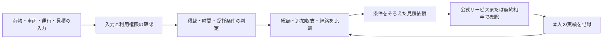

# Backfull 総合レビューと100点の受入条件

確認日：2026年11月5～6日。判断・点数・改善仕様は、特記がない限りAIの提案です。顧客獲得数、売上、利用者のフィードバック、実利用者による効果測定は採点から除外しました。

現状の評価は **56 / 100点**です。地図、荷物条件の入力、参考運賃、見積回答の比較、3D積付けを組み合わせた構成には価値があります。空車と輸送費を減らすには、同じ荷物・車両・日時・費用条件を全画面で共有し、実際に選べる候補を判定できるようにすることを優先します。

現在、実際の求荷求車市場に接続して案件を検索・入札する機能は確認できません。全国地図は公開統計、便の検索は架空データです。全国の荷量差から、今日どこに空車があるか、いくらで契約できるかは分かりません。

この100点は、後述する20条件を満たす製品・実装の評価です。事業成功や全国の空車削減を保証する点数ではありません。レビューを書くことで100点に到達したとは扱いません。

## 1. 評価対象と証拠

対象は依頼された [GitHubリポジトリ](https://github.com/shirokuma-factory/hackathon_2026) に対応するローカル作業ツリーです。監査開始時のHEADは `b8127fd6aaa4d972a3817a65ed736c76e2c38ac8`、報告作成時は `5e68a31a2bc0b51ecdc0e6f7e61a710ea634766c` でした。別セッションのコミットと未コミット変更があるため、GitHub上の同一コミットだけを評価した報告ではありません。

- 本線でローカル公開モードの「市場を見る」「送り方を比べる」「空きを探す・つなぐ」を操作し、スクリーンショットを目視しました。
- 新宿区発・大阪市都島区着の比較では、経路カードの後に料金図が表示されることを確認しました。
- 400pxの評価は保存済みv34画像とCSSを主な根拠にしました。本線の画面幅変更では、直後の画像が縮小表示となったため、その画像をレスポンシブ表示の合否判定には使用していません。
- 4件の不具合はPythonで再現しました。コード・出力・ハッシュは [実装監査記録](./2026-11-06_implementation-audit.md) にあります。主要8ファイルは本線でも監査後にハッシュ一致を確認しました。
- 旧コミット `bb73ab2` の限定試験は103件成功・7件除外でした。現行全件試験の成功とは扱いません。
- 画面の独立評価は [デザイン監査記録](./2026-11-06_independent-design-audit.md) にあります。同記録の77点はデザイン単独の別評価で、この総合点に平均していません。
- 報告書の20項目・合計56点・満点100点・ローカル参照先・LF改行を機械確認しました。独立した最終確認では、事実の矛盾と採点基準の不整合について追加指摘はありませんでした。アプリの問題が修正されたという意味ではありません。
- アプリのコード修正、公開、会員登録、規約同意、入札、問い合わせ送信は実施していません。

## 2. 誰のどの判断を支援するか

最初に対象とする人は、中小荷主の出荷担当者と、中小運送会社の配車担当者を提案します。これはREADMEの対象に沿った製品上の選択であり、顧客調査済みという意味ではありません。

**中小荷主**は、荷物の寸法・重量・締切を満たす送り方を調べ、複数見積の総額を比較します。特に宅配の上限に近い荷物、かさばる少量出荷、車格の判断が難しい出荷が対象候補です。一般個人向け配送も追加できますが、事業者限定サービスと混同しない表示が必要です。

**運送会社の配車担当者**は、現在の車両位置と残り荷室、集配時刻、次便までの余裕から、追加の荷物を受けられるかを判断します。追加売上と追加費用を確認できれば、空車区間が短くなっても採算が悪化する案件を避けられます。

**運行管理者・営業担当者**には、荷待ちと荷役の記録、費用の根拠、協議用の書面が役立ちます。現在の荷待ち機能はこの用途として維持します。プロジェクト全体を荷待ち機能だけに縮小する提案ではありません。

空車削減の成立条件は、戻る方向の荷物が存在することに加え、日時・集配地点・荷室・温度・荷役設備・受託条件が一致し、当事者が受けることです。可視化は判断を助けますが、これらの不一致を解消したことにはなりません。

## 3. トラック市場について確認できたこと

求荷求車とは、運ぶ荷物を探す側と車両を探す側を結び付ける取引です。確認した各サービスを、すべて価格入札方式として説明するのは不正確です。

| 確認事項 | WebKIT | トラボックス | ハコベル | PickGo |
|---|---:|---:|---:|---:|
| 公開のサービス説明・規約 | ○ | ○ | ○ | ○ |
| 一般荷主向けの利用案内 | × | △ | ○ | ○ |
| 未登録者による全案件の自由な取引 | × | × | × | × |
| 外部接続APIの申請制度を確認 | ○ | △ | △ | △ |
| Backfullでの案件再表示の許諾を確認 | × | × | × | × |

○は今回の一次資料で確認、△は限定的・未確認、×は対象外または今回確認できた許諾が無いことを表します。API欄の△は「APIが存在しない」という意味ではありません。許諾欄の×も、将来許諾されないという意味ではありません。

各サービスの対象・取引方法・規約の根拠

**WebKIT**は会員制です。日貨協連の説明資料では、トラック協会・KIT参加協同組合に関する資格があり、荷主は対象外です。基本手順は検索後に相手と条件を交渉して成約します。同資料には、委託目的で他システムへ案件を掲載することなどを禁ずる規程の抜粋があります。現在の通常会員規程全文を確認したわけではありません。[日貨協連説明資料・中国運輸局掲載](https://wwwtb.mlit.go.jp/chugoku/content/000364965.pdf)、[公式入会案内](https://www.wkit.jp/top/information/)

APIは存在します。公式の申請書は、利用サービス名、構築主体、目的、協同組合等の申請、API利用細則への同意を求めます。確認できたのは申請制度であり、Backfullの取得・再表示・商用利用が認められた事実ではありません。[公式APIキー発行申請書](https://www.wkit.jp/kit_doc/%E6%A7%98%E5%BC%8F8_API%E5%88%A9%E7%94%A8%E7%94%B3%E8%AB%8B.pdf)

**トラボックス**には公開の抜粋・デモ検索があります。登録FAQは一般貨物・軽貨物運送事業者を案内しています。通常市場への一般荷主の新規参加資格は今回確定できませんでした。大手荷主向けには別サービスのプライベートトラボックスがあります。[登録FAQ](https://www.trabox.ne.jp/support/qa_trabox.html)、[プライベートトラボックス](https://www.trabox.ne.jp/private/)

通常の交渉は会員自身が行います。公式規約ページには会員ページ情報の二次利用禁止があり、埋め込み規約には目的外利用・同種サービス等の制限があります。会員本人が提供したから自由に集約できる、とは判断できません。[公式規約](https://www.trabox.ne.jp/corporate/rules.html)

**ハコベル**は企業・個人向けの運送手配を案内しています。確認した運送手配規約では、申込みを同社が承諾して運送契約が成立します。会員の荷物を誰でも閲覧できる公開掲示板とは扱いません。規約には他の利用者の情報収集に関する禁止項目があります。[公式利用ガイド](https://www.hacobell.com/guide/64/91)、[運送手配利用規約](https://www.hacobell.com/terms/cargo)

ハコベルの規約は2026年10月1日改定と表示された公式検索結果で確認しました。ページ本文の直接取得は403でした。外部案件APIの仕様・再表示許諾は未確認です。配車管理製品の連携機能と、運送手配市場の案件取得権限は区別します。

**PickGo**の荷主規約では、登録パートナーが受託を申し出て、荷主が承諾する手順等が記載されています。一般貨物パートナーのFAQは、自社車両・自社運転者、再委託不可等の条件を案内しています。荷主規約には第三者へのアカウント情報開示や秘密情報に関する制限があります。案件一覧をBackfullへ集約する権利は未確認です。[荷主規約](https://pickgo.town/terms)、[公式FAQ](https://pickgo.town/faq)

取引市場から参考にするべき設計は、荷物・車格・時間の絞り込み、公開先の制限、取引相手の資格、支払条件、承諾後の書面、状態の更新です。既存市場には検索・地図・標準的運賃の表示を持つものもあり、地図を作ることだけでは違いを説明しきれません。Backfullには、利用者自身の荷物・原価・次便まで含めた比較を追加することを提案します。

## 4. 今の製品への追加方法

**先に追加する方式**は、利用資格付きの公式サービス案内と、利用者が持ち込み権限を持つ見積の比較です。見積依頼条件をBackfullで整え、公式サービスを本人が開いて検索・交渉・契約します。提携済み・直接予約可能と誤認させない表示にします。

サービス案内のデータには、対象者、車種、対象荷物、地域、温度条件、荷役条件、料金の提示方式、契約相手、公式URL、確認日を入れます。非公開の案件一覧、連絡先、会員資格情報は収集しません。URLへの荷物・住所の埋め込みも初期仕様に含めません。

**自社データの取り込み**では、利用者が権限を持つ配車表・運行実績・見積を使います。会員サイトの画面や通知メールを手動入力しても、元サービスの規約を回避できるわけではありません。

**API接続を追加する段階**では、取得項目、利用者別の権限、再表示先、保存期間、削除と失効、呼出回数、商用利用、費用、発注操作の範囲を運営者の許諾と照合します。WebKITは申請制度を調べる具体的な候補です。現時点で接続可能と表示しません。

公開運賃表についても、社名を伏せることと利用許諾は別です。現行の公開モードは運賃表ファイルの直接配信を止めますが、画面では各社公表値に基づく試算額を返します。サーバー内の計算、API応答、書き出し、GitHub配布も個別に確認する必要があります。ヤマト運輸のサイト規約は、法令で認められる場合を除く複製・転載・改変等に事前許諾を求めています。数値の計算利用の適法性まで、この規約だけで断定はできません。[ヤマト運輸サイト利用条件](https://www.kuronekoyamato.co.jp/ytc/sitepolicy/)

データの利用条件台帳には、原典、規約、確認日、保存・加工・計算・結果公開・再配布・商用利用の判断、許諾証拠、更新期限、未確認事項を分けて残します。根拠が未確認の用途は、許諾済みとして出荷しない基準にします。

## 5. 優先する可視化

| 可視化 | 荷主 | 配車担当 | 運行管理者 | 実装優先度 |
|---|---:|---:|---:|---:|
| 車格別の積載・台数・総額比較 | ○ | ○ | △ | 1 |
| 追加売上と追加費用の内訳 | △ | ○ | ○ | 1 |
| 集荷から次便までの時間軸 | ○ | ○ | ○ | 1 |
| 自社の実車・空車・不明区間の地図 | △ | ○ | ○ | 2 |
| 同じ条件での見積比較 | ○ | ○ | △ | 1 |
| 全国の貨物流動の偏り | △ | △ | △ | 3 |

可視化で何を決めるか、必要な入力、注意点

**車格別の比較**は、2t・4t・10t等について、載る個数、必要台数、重量・床・容積、入口寸法、装備、概算の範囲を同時に示します。荷物の積重ね可否・回転可否、車両個体の内寸と最大積載量を使います。3Dは同じ車両ID・荷物版から描画します。配置を探索できなかった結果は「確認が必要」と分けます。軸重・荷崩れ防止を検証していなければ、安全に運行できるとの判定は出しません。

**費用の内訳**は、基本運賃、高速代、燃料加算、集配、待機、荷役、設備、保険、税を積み上げた横棒で示します。不明な費目は0円に変換しません。荷主に見せる支払総額と、運送会社だけが見る原価を分けます。

**時間軸**は、移動、集荷待機、積込、幹線走行、荷卸し、休憩、次便の受付時刻を並べます。直線距離や運転時間だけで締切に間に合うと判定しません。労働時間・休息の制約は適用条件と規則の版を記録し、未取得の勤務履歴がある場合は判定を保留します。[厚生労働省・改善基準告示](https://driver-roudou-jikan.mhlw.go.jp/truck/notice)

**自社の空車地図**は、積込・荷卸し記録と走行区間を対応させ、積荷が不明な区間を別表示します。GPSの移動だけでは積荷の有無を確定しません。往路・復路の曜日と時刻、同じ場所へ繰り返し戻る便を一覧にし、候補荷物を載せた場合の追加距離と時間を出します。

**見積比較**は、同じ荷物・区間・日時の版にそろえます。総額、費目の不足、有効期限、受託確認、取消条件を並べ、完全な回答だけを順位に入れます。`quotes.py` の既存判定を、メインの比較図にも広げる方針です。

**全国の地図**は残します。表示名を「全国の物流傾向」にし、実案件の市場と区別する提案です。現在の2021年3日間の荷量差、2025年度の車両統計、直近の交通観測は期間と単位が異なります。重ね合わせから空車数を直接算出しません。市区町村の推定は配分方法と不確実性を表示します。流動の色は物流の偏り、別レイヤーの色は本人の実績とし、同じ意味に見える表示を避けます。

料金判断では、次の3つを分けます。

1. **国の標準的運賃**は、法令を守り事業を継続する際の参考として示された水準です。今その便を発注できる価格とは扱いません。[関東運輸局の説明](https://wwwtb.mlit.go.jp/kanto/kankou/hyoujyun_unchin.html)
2. **会社の原価に基づく希望額**は、利用者が入力した燃料・人件費・車両費等から求めます。帰り荷の短期判断には追加費用を、継続的な採算には固定費配賦も含む総原価を表示します。
3. **相手から得た有効な見積額**は、同じ条件・同じ費目にそろえて比較します。値引率や空き率だけで適正価格を決定しません。

追加収支の計算例として、追加売上24,000円、追加費用14,000円なら差額は10,000円です。これは説明用の仮定です。固定費配賦前であり、会社の純利益ではありません。次便を失う費用やキャンセル条件も別に確認します。値下げだけで輸送費を減らす設計にはしません。

## 6. 入力と計算を統一する仕様

荷物には、発着住所・受渡し可能時間、品目、個数、各寸法・重量、梱包、積重ね、温度、危険物、荷役設備、受託上の制限を持たせます。車両には、車両ID、内寸・開口部、最大積載量、現在積載、空き位置・時刻、装備、次便の条件を持たせます。

費用には、通貨・税、基本運賃、含む費目、別途費目、不明費目、見積有効期限、運送会社、契約当事者を持たせます。各値には、入力者、出典、確認日、実測・推定・仮定の区別を付けます。

荷物版・車両版・運行版を共通で参照し、どれかが変わったら積載・料金・予約・書面を再評価します。全項目を初回から要求せず、分かる範囲で概算を示し、確定に不足する情報を画面上で特定します。

## 7. 先に直す具体的な不具合

優先度1は、積載・予約・書面の結果を誤らせる事項です。次の4件は [再現コードと実測結果](./2026-11-06_implementation-audit.md) を残しています。

- **床面積の超過を予約できます。** 登録便の総床残量が未設定になり、13m²の荷室に合計240m²の荷物が仮予約されました。重量と1個の寸法だけの検査では不足します。`src/shipcompare/spaceb.py:385, 733`。
- **出発済みの便を予約できます。** 2020年発着の便に2026年11月5日の時計で予約し、仮予約が成立しました。受付締切と出発時刻を検査し、期限を出発後まで延長できないようにします。`spaceb.py:417`。
- **途中降ろしの契約下書きが誤ります。** 大阪市中央区へ届ける荷物をT7へ予約すると、書面に便の終点の加古川市が出ました。荷物の配送区間から作成する必要があります。`spaceb.py:525`。
- **配置を見つけられない場合を積載不可と断定します。** 4×4×1mの荷室に、3×2×1mを2個と4×1×1mを1個は配置できますが、実装は2個までとして×を返しました。探索の未成功と、重量・寸法による明確な不適合を分けます。`loadplan.py:215`、`web/loadview.js:16`。

加えて、料金計算の4t車は最大4,000kg、積載図の4t公表例は2,700kgで、同じ車両条件になっていません。料金候補の絞り込みも重量中心です。車格名だけを共通にする修正では足りません。`estimate.py:398`、`loadplan.py:78`。

比較図の「最安」は、受託・積載・費目の確認待ちを順位へ反映していません。最安の参考額と、条件がそろった確定見積の最安を区別します。経路のOSRMは乗用車向けの経路で、大型車の車高・重量制限に適合した経路だとは扱いません。

## 8. デザインの変更案

地図と3Dを維持し、判断する順序を変えます。最初に「荷物を送りたい」「運送会社として比較したい」「全国の傾向を見たい」を選べるようにします。荷待ち機能も直接開けるようにします。

比較画面の上部には、条件を満たす候補、必要台数、総額または未確認費用、到着条件をまとめます。その下に、料金の内訳、時間軸、地図・3D、出典の順に置きます。PCでは地図と比較を並べ、スマートフォンでは比較を先に表示します。経路だけを見たい場合は展開して確認できます。

小さな薄い文字に、価格前提と出典を置かない方針です。CSS指定色の一例の明暗比は3.42でした。通常文字の受入目標を4.5以上とし、地図上でも確認します。`title`属性の説明はタップとキーボードで開ける本文に移します。3Dを閉じた際は元のボタンへフォーカスを戻します。

「載りません」は、寸法不適合、時間不適合、集荷範囲外、受託条件不適合、配置未確認に分けます。現在の便一覧では、集荷地点が遠い場合も「載りません」と表示され、何を変えればよいかが見出しから伝わりません。

空の検索結果では、どの制約で候補が無くなったかを示します。日時や車格の変更は利用者が選び、荷物寸法・安全条件・納期を自動的に緩めません。

## 9. 100点の採点基準

各項目5点、20項目で100点です。0は機能・根拠なし、1は設計・固定例の段階、2は一部実装に重大な不足、3は通常の流れがあるものの重要な確認が残る状態、4は主要部分がそろい改善が限定的、5は記載した受入条件を証拠付きで満たす状態とします。現状点は本レビューによる判断で、公式審査の点数ではありません。

| 分野 | 現状 | 満点 |
|---|---:|---:|
| 誰の判断をどう支えるか | 16 | 20 |
| データと市場の扱い | 7 | 20 |
| 運べる・採算が合うという判定 | 6 | 20 |
| 可視化と操作 | 13 | 20 |
| 記録・検証・再現性 | 14 | 20 |
| 合計 | 56 | 100 |

| 項目 | 現状 | 満点 |
|---|---:|---:|
| 01 対象者と困る場面 | 4 | 5 |
| 02 荷主の比較と依頼 | 4 | 5 |
| 03 運送会社の判断と記録 | 4 | 5 |
| 04 デモと実用範囲の説明 | 4 | 5 |
| 05 データの単位・期間・根拠 | 4 | 5 |
| 06 利用条件と配信範囲 | 2 | 5 |
| 07 自社データの取り込み | 1 | 5 |
| 08 実在サービスへの接続方法 | 0 | 5 |
| 09 積載と車両の整合 | 2 | 5 |
| 10 総額と運送会社の採算 | 2 | 5 |
| 11 時間と運行制約 | 1 | 5 |
| 12 予約と書面の整合 | 1 | 5 |
| 13 地図と3Dの役割 | 4 | 5 |
| 14 比較結果の優先表示 | 3 | 5 |
| 15 読みやすさとキー操作 | 3 | 5 |
| 16 入力・空結果・スマートフォン | 3 | 5 |
| 17 見積の版と期限 | 4 | 5 |
| 18 効果の計算と根拠の追跡 | 3 | 5 |
| 19 再現可能な試験 | 4 | 5 |
| 20 保存・権限・障害時の表示 | 3 | 5 |

20項目それぞれを5点にする受入条件

01. 荷主と配車担当それぞれについて、入力する情報、決める内容、出力を1画面で説明できます。一般個人・事業者限定の資格も区別します。

02. 荷物を1回入力し、条件を満たす送り方の比較、依頼文、回答見積の比較まで同じ条件で進めます。不明情報を補っていないことが分かります。

03. 自社便に追加荷物を受けた場合の荷室・時刻・追加収支と、その根拠を出せます。採算条件を満たさない案件を推薦しません。荷待ち書面へも同じ記録を使えます。

04. 全画面・出力に、実データ、架空例、推定を表示します。「市場を見る」が実案件検索と誤認されない名称と説明になり、未接続サービスを接続済みと表示しません。

05. 数値から原典・対象・期間・単位・計算式を確認できます。年計、3日間、直近週、トン、車両台数、空車距離を混ぜた結果を出しません。推定市区町村値と実測値を区別します。

06. 利用条件台帳に基づいて、保存、加工、計算、結果公開、再配布を制御します。根拠が未確認の用途は停止できます。API応答・静的ファイル・書き出し・GitHubを確認します。

07. 権限のある配車表・運行記録を実際に読み込み、列の対応、単位、欠損、重複、誤った日付を確認できます。元行へ戻って訂正でき、不明区間を空車に数えません。匿名の試験ファイルで検証できます。

08. 条件と利用資格に応じて公式サービスへ案内でき、取引先と次の操作が明確です。外部案件の再表示を行う場合だけ、許諾と会員権限を検証します。市場APIの契約獲得自体は採点条件にしません。

09. 車両個体の内寸・開口部・最大積載量・装備を積載図と料金候補で共有します。重量超過、床超過、積重ね不可、必要台数、配置探索の未解決を区別し、今回の過容量再現を拒否します。

10. 同じ条件の費目をそろえ、未確認費用がある場合は確定総額や確定利益を表示しません。標準的運賃、公表表による試算、会社の希望額、相手の見積を区別します。追加収支と総原価を別に出します。

11. 集配時間、荷役、待機、休憩、次便、車両通行制限を確認します。必要な履歴や経路制約が欠けている場合は判定保留です。過去便・受付締切後・間に合わない荷物を除外できます。

12. 予約、承諾、辞退、失効で容量が整合し、書面の発着地・日時・数量・金額が荷物の予約内容と一致します。仮予約を実際の取引機能として公開する場合は、別端末共有、永続保存、本人の権限、同時予約を検証します。デモのままなら取引成立と誤認させません。

13. 地図の選択と比較カードが連動し、選んだ車両で3Dを開けます。地図の線・色・動きが表す値を説明でき、操作を減らすために使われます。アニメーション停止と表による代替があります。

14. 着地選択直後に、手段、可否、費用の確度、日数が同時に見えます。詳細経路を読む前に候補を比較できます。最安の見出しには比較対象と未確認条件が反映されます。

15. キーボードだけで入力・比較・3D開閉を完結できます。フォーカスが見え、ダイアログ内の移動と復帰が機能します。価格前提をタップで読め、重要文字の明暗比を確認します。

16. 400×800と1920×1080で、比較の要約と次の操作が確認できます。登録の基本・追加条件を整理し、未入力、候補ゼロ、通信失敗から復帰できます。入力を勝手に消しません。

17. 古い荷物条件の見積、期限切れ、不足費目を順位から外します。金額図、詳細、依頼文、保存後の再読込が同じ版を参照し、変更前の判断も追跡できます。

18. 空車距離率、実車距離率、積載の重量・床・容積を混同しません。削減試算は、追加集配を含めた基準案との差を同一対象で計算します。観測していないCO2や削減率を実績表示しません。実顧客の導入結果は不要です。

19. 今回の4再現、料金費目、版、期限、CSV欠損、同時予約を含む境界試験を固定データと固定時計で実行できます。第三者が同じ手順で結果を再現でき、最新の対象版で必要試験が通ります。

20. 保存先・保存期間・削除方法が明確で、他者の原価・住所・見積を権限なしで読めません。再起動後の復元、外部データ取得失敗、古いデータ、取り消し時の表示を確認します。非共有のローカル計算と共有取引の保存方法を混同しません。

## 10. 実装順と完了判定

**最初の変更群**では、床容量、出発時刻、途中降ろし書面、配置判定の4件を修正し、再現試験を通します。同時に車両IDと荷物版を統一する設計を確定します。見た目の拡張より先に結果の整合を確保します。

**次の変更群**では、積載条件を満たす車両の総額比較、追加収支、時間軸を実装し、比較要約を上へ移します。全国地図と3Dをこの比較に連動させます。

**続く変更群**では、自社ファイルの読み込み、規約台帳、資格付きの外部サービス案内を追加します。実案件APIの接続は、取得・再表示条件が確認できたサービスだけを別作業として進めます。

**最後の確認**では、400pxとPCのスクリーンショット、キーボード操作、条件変更、保存後の再読込、金額不明、締切超過を検証します。各項目の証拠ファイルを添えて採点し直します。未解決の項目に満点を付けず、顧客獲得やフィードバック不足を減点理由に加えません。

現状の強い部分は、公開情報を調べて荷物の条件と比較する構成と、見積の版・期限・不足費目を扱う実装です。これを、利用者の実データに基づいて「運べる・間に合う・総額と採算が説明できる」判断までつなげることが、今回選んだ改善方針です。
