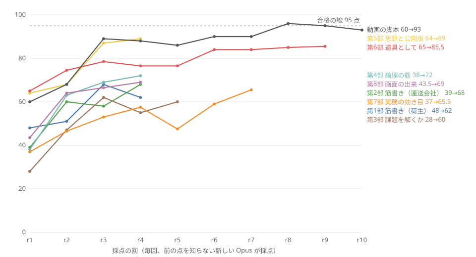

# 試行錯誤の記録（2026-11-03〜11-07）

審査基準「深さと実行力」の 1 つ目（最初のアイデアにとどまらず、試行錯誤を重ねて磨き上げたか）に、記録で答えるページです。詳しい経緯は [DEVLOG](DEVLOG.md) にあります。

## 数字で見る 6 日間

| 項目 | 値 | 確かめ方 |
|---|---:|---|
| コミット（提出のブランチ） | 263 | `git rev-list --count HEAD`（2026-11-08 01:51 の時点） |
| 採点・監査の記録 | 87 件 | `docs/reviews/*.md` |
| 計画・判断の記録 | 35 件 | `docs/plan/*.md` |
| 採点の基準を替えた回数 | 8 部（第 1〜8 部）＋動画の脚本 | [採点の推移](reviews/2026-11-05_筋書き_採点の推移.md) |
| 自動試験 | 127 → 727 → 1,442 → 2,086 件 | `uv run pytest --collect-only -q` |

| 日 | コミット | 自動試験 |
|---|---:|---:|
| 11/3 | 42 | 127 → 185 |
| 11/4 | 16 | — |
| 11/5 | 72 | 727 → 764 |
| 11/6 | 38 | 1,442 |
| 11/7 | 60 | 1,956（集めた数） |
| 11/8 | 35 | 2,083（集めた数） |

## 採点の推移

採点は毎回、前の点を知らない新しい Opus のエージェントが行いました。第 6〜8 部は 2 人が別々に採点し、図は 2 人の平均です。点が頭打ちになったとき、文を直し続けるのをやめて、基準か作り方を替えました（下の表）。

## 作り直した判断

| 日 | 何が分かったか | 何を変えたか | 記録 |
|---|---|---|---|
| 11/3 | 最初に作ったのは、計画 08 の「スポット出荷の見積比較」（Streamlit）。作成者が求めていたのは、地図を中心に市場の偏りを見る道具（作成者の構想）だった | 地図の Web アプリに作り直した。Streamlit の版は捨てた | [地図中心への作り直し](plan/2026-11-03_地図中心への作り直し.md) |
| 11/5 | 筋書きの文書を 4 回直しても、差が採点者ごとのぶれ（±6 点）より小さい。指摘の多くは「アプリがまだそれをしない」 | 文書を直すのをやめ、仕様（SPEC §21・§22）を書いて実装し、画面と試験で採点を続けた | [採点の推移](reviews/2026-11-05_筋書き_採点の推移.md) |
| 11/5 | 第 3 部「課題を解くか」は 55〜62 点で頭打ち。実在の利用者がいないので、架空の人物の判断に頼っていた | 一次資料からの論理で採る第 4 部に基準を替えた。実データに関わる指摘が 6 → 2 → 1 → 1 件と減ったところで止めた | [課題を解くツールになっているか](plan/2026-11-05_課題を解くツールになっているか.md) |
| 11/5 | 見積比較に寄って、元の思想（見えていないものを見せる、つなぐ、地図が中心）から離れていた | 元の思想を基準に入れた第 5 部で採点した。実在 3 社の名と運賃を画面から外した | DEVLOG 11/5「元の思想に戻す」 |
| 11/6 | 外部の監査（Codex）で、床 13m² に 240m² を載せるなどの不具合が見つかった | 本線が再現して本物と確かめ、SPEC §34 で直した | [監査](reviews/2026-11-06_implementation-audit.md) |
| 11/6 | 実務の効き目（第 7 部）は 34・40 点。仕事が確かに減るのは、荷待ちの記録から協議の書面までの流れだけ。配車担当の毎日の仕事は減らない | 配車表の書き方を追いかけるのをやめ、列の役割の選択とひな形で受けた。自社の運行をファイル 1 枚で開けるページにした | [原点に戻った検証](plan/2026-11-06_原点に戻った検証.md) |
| 11/7 | 画面の出来（第 8 部）は 45・42 点。情報が多すぎ、役割を選んでも最初のカードが消えない | 最初の画面を「役割 → 用途の問い → 答えの誘導」にし、画面の文字数の上限を試験で数えた | DEVLOG 11/7「夜通しの画面の作り直し」 |

## 試して採らなかったもの

| 試したもの | 採らなかった理由 | 記録 |
|---|---|---|
| Streamlit の見積比較 | 作成者の求めた形と違った | 上の 11/3 |
| ローカル LLM（Ollama、LM Studio） | 作成者の判断で見送った。額と判定は試験で確かめた関数で出し、AI の回答で決めない | DEVLOG 11/3 |
| 実在 3 社の名前と運賃を画面に出す | 運賃表の再配布の条件が確かめられない | DEVLOG 11/5 |
| ComfyUI で画面の絵の画風を仕上げる | 元の Blender の絵より良くならなかった | DEVLOG 11/7 |
| AI 生成の動画（MiniMax H3）を動画の冒頭に使う | 権利の条件を確かめきれない。自作の地図の映像に替えた | [素材とデータの権利](素材とデータの権利.md) |
| 採点者の作る配車表の書き方に、毎回合わせる | 採点者が毎回新しい書き方を作るので、追いかけても終わらない | 上の 11/6 |

## 止めた判断

点が 100 に届かないまま止めた所があります。止めた理由を記録に残しています。

| 部 | 最後の点 | 止めた理由 |
|---|---:|---|
| 第 4 部 論理の筋 | 72 | 残る指摘が文言だけで、運送会社が自社の記録から得る計算・表・書面を変えない |
| 第 6 部 道具として | 85・86 | 2 人の点が採点者のぶれ（±3 点）の中に収まった |
| 動画の脚本 | 93（最高 96） | r8 から 93〜96 点で、採点者ごとのぶれの中に収まった |
| 第 7 部 実務の効き目 | 73・58 | 2 人とも「95 点には実在の会社のファイルでの確認が要る」と書いた。実在の利用者はいない（11/3 の作成者の判断） |
